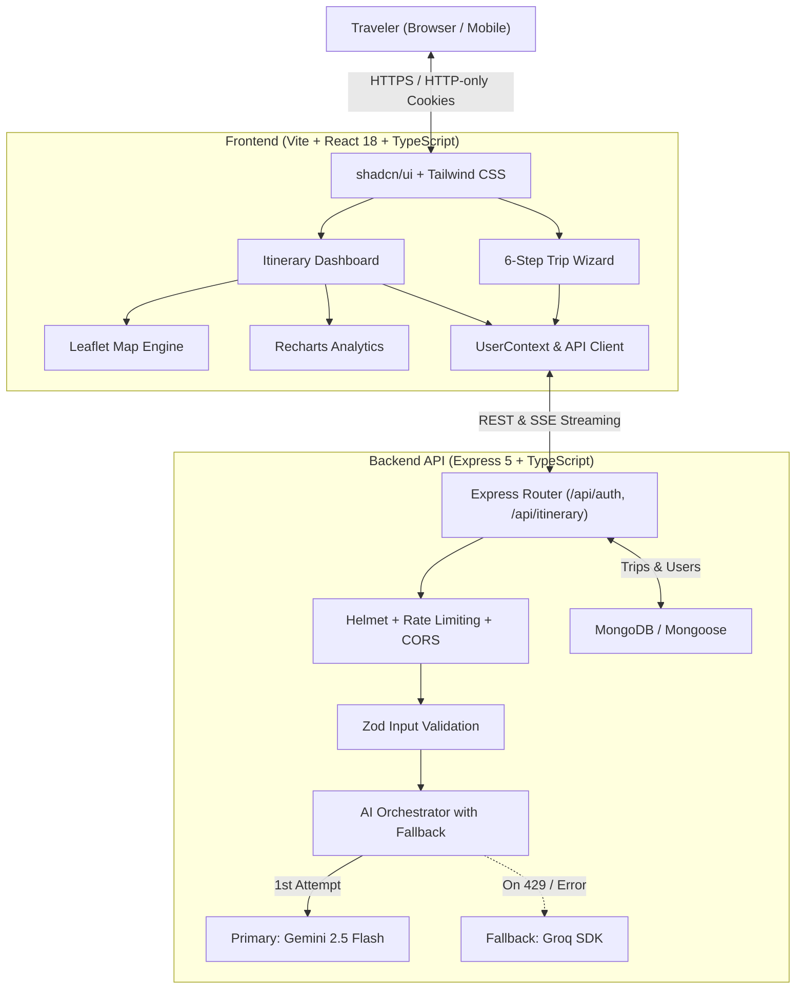

# ✈️ TravelAI — Intelligent AI Travel Companion & Itinerary Generator

[](https://www.typescriptlang.org/)
[](https://reactjs.org/)
[](https://vitejs.dev/)
[](https://tailwindcss.com/)
[](https://expressjs.com/)
[](https://www.mongodb.com/)
[](https://ai.google.dev/)
[](https://groq.com/)

> **TravelAI** is a modern, full-stack web platform that synthesizes bespoke, day-by-day travel itineraries in seconds. By pairing Google Gemini 2.5 Flash and high-speed Groq fallbacks with interactive maps, financial analytics, and multi-night stay deduplication, TravelAI transforms travel planning from hours of frustrating research into an effortless, personalized experience.

---

## 📌 Table of Contents
- [What Problem Does TravelAI Solve?](#-what-problem-does-travelai-solve)
- [Key Features](#-key-features)
- [System Architecture](#-system-architecture)
- [Monorepo Directory Structure](#-monorepo-directory-structure)
- [Tech Stack](#-tech-stack)
- [Getting Started](#-getting-started)
  - [Prerequisites](#prerequisites)
  - [Environment Configuration](#environment-configuration)
  - [Installation & Running Dev Server](#installation--running-dev-server)
- [API Reference](#-api-reference)
- [Responsive & Cross-Device Support](#-responsive--cross-device-support)
- [Deployment](#-deployment)
- [Security & Best Practices](#-security--best-practices)

---

## 💡 What Problem Does TravelAI Solve?

Traditional trip planning involves juggling dozen of browser tabs: reading conflicting travel blogs, estimating taxi fares, looking up weather advisories, checking permit requirements, and calculating budgets in spreadsheets. Furthermore, basic LLM prompts often generate flawed itineraries that suffer from:
1. **Unrealistic Pacing & Logistics**: Packing 10 far-apart attractions into a single afternoon without travel time.
2. **Hotel Hopping Fatigue**: Changing accommodations every single night instead of scheduling continuous stays.
3. **Hallucinated or Absent Map Coordinates**: Generic lists with no spatial context or geographic centering.
4. **Unrealistic Budgets**: Overlooking local transit, buffer reserves, permit fees, or regional payment realities (e.g. offline cash vs UPI in remote hill stations).
5. **API Quota Brittleness**: Application crashes when a single AI provider experiences rate limits or downtime.

**TravelAI solves all of these challenges with a production-grade, fault-tolerant travel intelligence engine.**

---

## ✨ Key Features

### 🧠 Dual-Provider AI Streaming Pipeline
- **Primary Model**: Powered by Google's latest **Gemini 2.5 Flash** for rapid reasoning and multimodal world knowledge.
- **Instant Fallback**: Automatic failover to ultra-low-latency **Groq (`openai/gpt-oss-120b` / `qwen/qwen3.8-27b`)** upon rate limits (429) or API disruptions.
- **Live SSE Streaming**: Multi-stage progress indicators keeping users engaged while the itinerary synthesizes in real time.

### 🧭 6-Step Visual Trip Wizard
- **Destination Discovery**: Search bar with auto-suggestions and trending Indian hotspots (Goa, Manali, Wayanad, Jaipur, Ladakh, etc.).
- **Smart Calendar**: Departure/return pickers with duration presets (Weekend Getaway, 5-Day Recharge, 1-Week Vacation).
- **Group Presets & Custom Pacing**: Solo, Couple, Family, and Friends modes with independent adult and child count adjusters.
- **Dynamic Budget Allocator**: Per-person and total group budget sliders with automatic category allocation.
- **Vibe & Style Filters**: Adventure, Culture, Relaxation, Culinary, Nature, Photography, Nightlife, and Shopping.

### 🗺️ Interactive OpenStreetMap & Leaflet Visualization
- **80+ Curated Travel Hub Coordinates**: Pre-mapped coordinates covering hill stations, beaches, and cultural centers across India.
- **Dynamic Nominatim Geocoding**: Automatically geocodes custom or unlisted destinations if not found in the local coordinate cache.
- **Day-by-Day Route Polylines**: Connects scheduled daily activities with color-coded travel routes.
- **Interactive Pins**: Custom numbered activity markers and distinctive hotel icons with detailed popups.

### 🏨 Smart Multi-Day Stay Deduplication
- Automatically detects and merges multi-night reservations at the same property across consecutive days into consolidated cards (e.g. `Stay Duration: Days 1 – 4 (4 Nights)`), eliminating repetitive cards.

### 📊 Financial & Budget Analytics (Recharts)
- **Interactive Donut Breakdown**: Visualizes expenses across Accommodation, Food & Drinks, Activities, Local Transit, and Buffer.
- **Daily Spending Rhythm**: Projected daily cashflow bar charts.
- **Emergency Reserve & Payment Guide**: Dedicated ~10% contingency calculation with regional UPI vs Cash acceptance guidance.

### 📤 Seamless Sharing, Export & Print
- **Public Read-Only Web Links**: Unique share tokens allowing friends or family to explore the itinerary without needing an account.
- **Instant Messenger Text Export**: Formatted, emoji-rich summary ready for WhatsApp, Telegram, or Email.
- **JSON Data Backup**: Full raw data export.
- **Dedicated Print Stylesheet**: Browser print-to-PDF styles that hide navigation bars and reformat cards for clean physical paper printing.

### 📱 Mobile-First Responsive Design
- Optimized for all screen sizes from ultra-compact smartphones (320px iPhone SE) and tablets to 4K desktop displays.
- Touch-friendly 44px min-height targets, scrollable pill selectors, and mobile drawer navigation.

---

## 🏗️ System Architecture



---

## 📁 Monorepo Directory Structure

```text
travelai/
├── package.json               # Root monorepo runner (concurrently backend + frontend)
├── .gitignore                 # Root gitignore (strictly excludes secrets and builds)
├── README.md                  # Comprehensive system documentation
│
├── backend/                   # Node.js + Express 5 + TypeScript REST API
│   ├── .env.example           # Environment template
│   ├── package.json
│   ├── tsconfig.json
│   ├── vercel.json            # Vercel serverless deployment configuration
│   └── src/
│       ├── index.ts           # Server entry point & middleware pipeline
│       ├── db.ts              # MongoDB Mongoose connection
│       ├── config/
│       │   └── env.ts         # Zod-validated environment config
│       ├── controllers/
│       │   ├── auth.controller.ts       # Signup, Signin, Logout, Me
│       │   └── itinerary.controller.ts  # Generation, CRUD, Sharing, Streaming
│       ├── middleware/
│       │   ├── auth.middleware.ts       # JWT cookie authorization
│       │   ├── error.middleware.ts      # Global centralized error handler
│       │   ├── rateLimiter.middleware.ts# Rate limiting (auth & AI generation)
│       │   └── validate.middleware.ts   # Zod schema request validator
│       ├── models/
│       │   ├── Trip.ts        # Itinerary schema with sharing tokens
│       │   └── User.ts        # User credentials schema
│       ├── routes/
│       │   ├── auth.routes.ts
│       │   └── itinerary.routes.ts
│       ├── schemas/           # Zod validation schemas
│       ├── services/
│       │   ├── auth.service.ts
│       │   └── ai/
│       │       ├── ai.interface.ts      # AIService abstraction
│       │       ├── gemini.service.ts    # Google Gemini 2.5 Flash implementation
│       │       ├── groq.service.ts      # Groq high-speed fallback implementation
│       │       ├── prompt.ts            # Detailed travel intelligence prompt
│       │       └── index.ts             # Orchestrator with fallback
│       └── types/             # Shared backend TypeScript types
│
└── frontend/                  # React 18 + Vite + TypeScript Client
    ├── index.html             # HTML5 entry with mobile viewport & theme initialization
    ├── package.json
    ├── vite.config.ts
    ├── tailwind.config.ts
    └── src/
        ├── App.tsx            # Main routes & QueryClient setup
        ├── config.ts          # API Base URL resolver
        ├── components/
        │   ├── Navbar.tsx     # Responsive navbar with mobile sheet drawer & dark mode
        │   ├── Hero.tsx       # Auth-aware responsive hero section
        │   ├── FeatureCard.tsx
        │   ├── ErrorBoundary.tsx
        │   ├── ItineraryDisplay.tsx # Multi-tab coordinator
        │   ├── dashboard/
        │   │   ├── TripHeader.tsx       # Visual cover, quick stats & export triggers
        │   │   ├── DayTimeline.tsx      # Vertical timeline with editable activities
        │   │   ├── TripMap.tsx          # Leaflet map with 80+ destinations & routes
        │   │   ├── StayAndCuisine.tsx   # Consolidated stay cards & dining hotspots
        │   │   ├── BudgetVisualizer.tsx # Donut and bar charts + UPI advice
        │   │   ├── TravelGuideSafety.tsx# Climate, packing checklist & etiquette
        │   │   ├── ShareExportModal.tsx # Public link, WhatsApp text & PDF print
        │   │   └── MyTripsView.tsx      # Library view with search, filter & duplicates
        │   └── wizard/
        │       ├── WizardProgress.tsx   # 6-step progress bar with mobile scaling
        │       ├── StepWhere.tsx        # Destination search & popular hotspots
        │       ├── StepWhen.tsx         # Date range pickers & duration presets
        │       ├── StepWho.tsx          # Group type selector & traveler counters
        │       ├── StepBudget.tsx       # Interactive budget slider & INR tiers
        │       ├── StepStyle.tsx        # Travel vibe & interest selectors
        │       ├── StepReview.tsx       # Pre-submission review & validation
        │       └── GenerationOverlay.tsx# Live streaming generation animation
        ├── pages/
        │   ├── Landing.tsx    # Marketing homepage
        │   ├── TripPlanner.tsx# Full wizard journey
        │   ├── Dashboard.tsx  # User itinerary view & trip library
        │   ├── SharedTrip.tsx # Public read-only trip viewer
        │   ├── Auth.tsx       # Login & signup
        │   └── NotFound.tsx
        ├── services/
        │   └── api.ts         # Type-safe API client with SSE stream reader
        └── types/
            └── trip.ts        # Comprehensive itinerary data contract
```

---

## 🛠️ Tech Stack

| Layer | Technologies |
|---|---|
| **Frontend** | React 18, TypeScript, Vite, Tailwind CSS, shadcn/ui, Lucide Icons |
| **Mapping & Visuals** | Leaflet, React-Leaflet, OpenStreetMap, Recharts |
| **Backend** | Node.js (v20+), Express 5, TypeScript, tsx |
| **Database** | MongoDB, Mongoose ODM |
| **Artificial Intelligence** | Google Generative AI SDK (`gemini-2.5-flash`), Groq SDK |
| **Security & Validation** | Zod, Helmet, express-rate-limit, bcryptjs, jsonwebtoken, cookie-parser |
| **Deployment** | Vercel (Serverless Backend + Static Frontend), Docker-ready |

---

## 🚀 Getting Started

### Prerequisites
- [Node.js](https://nodejs.org/) (v20.x or later recommended)
- [MongoDB](https://www.mongodb.com/) (Local instance or MongoDB Atlas cluster URI)
- [Google AI Studio API Key](https://aistudio.google.com/) for Gemini
- [Groq API Key](https://console.groq.com/) (Optional, recommended for fallback resilience)

### Environment Configuration

Create a `.env` file in the `backend/` directory (you can copy `backend/.env.example`):

```bash
cp backend/.env.example backend/.env
```

Populate the required credentials:

```env
# Server Port
PORT=5000
NODE_ENV=development

# Database Connection
MONGODB_URI=mongodb+srv://<user>:<password>@cluster.mongodb.net/travelai?retryWrites=true&w=majority

# JWT Authentication Secret
JWT_SECRET=super_secret_jwt_passphrase_change_me_in_production

# AI Provider API Keys
GEMINI_API_KEY=AIzaSy...your_gemini_api_key_here
GROQ_API_KEY=gsk_...your_groq_api_key_here

# Frontend URL (for CORS allowance)
FRONTEND_URL=http://localhost:8080
```

> **Note**: Both the root and subfolder `.gitignore` files strictly ignore `.env` files. Secrets are never tracked or committed to version control.

### Installation & Running Dev Server

You can install and run both backend and frontend concurrently with a single command from the project root:

```bash
# 1. Install all dependencies across root, backend, and frontend
npm run install:all

# 2. Run backend (Port 5000) and frontend (Port 8080) simultaneously
npm run dev
```

Visit **`http://localhost:8080`** in your browser.

#### Running Individually

**Backend only:**
```bash
cd backend
npm install
npm run dev
```

**Frontend only:**
```bash
cd frontend
npm install
npm run dev
```

---

## 📡 API Reference

### Authentication Endpoints (`/api/auth`)
| Method | Endpoint | Description | Auth Required |
|---|---|---|---|
| `POST` | `/api/auth/signup` | Create account & set HTTP-only cookie | No |
| `POST` | `/api/auth/signin` | Sign in & set HTTP-only cookie | No |
| `POST` | `/api/auth/logout` | Clear auth cookie | Yes |
| `GET` | `/api/auth/me` | Fetch authenticated user profile | Yes |

### Itinerary Endpoints (`/api/itinerary`)
| Method | Endpoint | Description | Auth Required |
|---|---|---|---|
| `POST` | `/api/itinerary/generate` | Generate complete itinerary JSON | Yes |
| `POST` | `/api/itinerary/generate-stream` | Generate itinerary with Server-Sent Events (SSE) | Yes |
| `GET` | `/api/itinerary` | Retrieve all saved trips for current user | Yes |
| `GET` | `/api/itinerary/:id` | Fetch specific trip details by ID | Yes |
| `PUT` | `/api/itinerary/:id` | Update itinerary details or status | Yes |
| `DELETE`| `/api/itinerary/:id` | Delete trip from library | Yes |
| `POST` | `/api/itinerary/:id/duplicate`| Clone trip into a new editable draft | Yes |
| `POST` | `/api/itinerary/:id/share` | Generate public read-only share token | Yes |
| `GET` | `/api/itinerary/shared/:shareId`| Fetch public read-only trip (unauthenticated) | No |

---

## 📱 Responsive & Cross-Device Support

TravelAI has been designed and tested across multiple device categories:
- **Mobile Phones (320px – 480px)**: Compact step indicators, full-width touch actions, stackable budget switches, scrollable day pills, and safe modal height scrolling (`max-h-[92vh] overflow-y-auto`).
- **Tablets & iPads (768px – 1024px)**: 2-column card layouts, responsive Leaflet map controls, and flexible header stats.
- **Desktops & Laptops (1024px+)**: Full multi-column dashboard, 3-column cuisine grids, and side-by-side Recharts visualizations.

---

## 🚢 Deployment

### Option 1: Render Single Web Service (Recommended ⭐)
Deploy both the Express API and the Vite React frontend on a **single Render Web Service**. This uses only **1 free tier slot**, completely eliminates CORS cross-origin complexities, and ensures 100% reliable same-origin cookie authentication across all web browsers.

1. Go to your [Render Dashboard](https://dashboard.render.com/) and click **New +** → **Web Service**.
2. Connect your GitHub repository (`travelai`).
3. Set the following fields in the Render dashboard:
   - **Name**: `travelai` (or any name you prefer)
   - **Region**: Nearest to your users (e.g., *Singapore*, *Frankfurt*, *Oregon*)
   - **Branch**: `main`
   - **Root Directory**: *(Leave blank / empty)*
   - **Runtime**: `Node`
   - **Build Command**: `npm install && npm run build`
   - **Start Command**: `npm start`
   - **Instance Type**: `Free`
4. Add the following **Environment Variables**:
   | Variable | Value | Notes |
   |---|---|---|
   | `NODE_ENV` | `production` | Enables production optimizations |
   | `PORT` | `10000` | Default Render port |
   | `MONGODB_URI` | `mongodb+srv://...` | Your MongoDB Atlas connection string |
   | `JWT_SECRET` | *(Generate a 32+ character random string)* | Secret for auth tokens |
   | `GEMINI_API_KEY` | *(Your Gemini API Key)* | From Google AI Studio |
   | `GEMINI_MODEL` | `gemini-2.5-flash` | Fast, cost-efficient model |
   | `GROQ_API_KEY` | *(Optional)* | For automatic failover |
   | `SERVE_STATIC` | `true` | *(Optional, auto-detected when built)* |
5. Click **Create Web Service**. Render will automatically build the backend with `tsc`, compile the frontend with `vite build`, and serve both seamlessly from your single Render URL (`https://your-service.onrender.com`)!

> **Why Single Service?**
> - **Zero CORS Issues**: Because the frontend and backend share the exact same domain and port, there are no CORS headers or preflight requests needed.
> - **Bulletproof Auth Cookies**: Authentication cookies are treated as first-party (same-site), avoiding third-party cookie restrictions in Safari, Chrome, and Firefox.
> - **100% Free Tier Friendly**: Uses only 1 Render free service instance.

---

### Option 2: Split Render Services (Blueprint / render.yaml)
If you prefer decoupling the frontend as a Render Static Site and the backend as an Express Web Service, use Render's Blueprint feature with the provided [`render.yaml`](file:///d:/Projects/travelai/render.yaml).

---

### Option 3: Monorepo Vercel Deployment
The repository includes pre-configured [`backend/vercel.json`](file:///d:/Projects/travelai/backend/vercel.json) settings for deploying the API to Vercel Serverless Functions:
1. Connect the GitHub repository to [Vercel](https://vercel.com).
2. Configure Environment Variables in the Vercel dashboard (`MONGODB_URI`, `JWT_SECRET`, `GEMINI_API_KEY`, `GROQ_API_KEY`, `NODE_ENV=production`).
3. Deploy!

### Production Build Verification
To verify the full production build locally from the monorepo root:

```bash
# Builds both backend (tsc) and frontend (vite build)
npm run build
```

---

## 🔒 Security & Best Practices
- **No Secret Leaks**: Strict `.gitignore` configurations ensure zero `.env` or sensitive credentials enter git history.
- **HTTP-Only Cookies**: Authentication tokens are stored in `httpOnly`, `secure`, `sameSite: none` cookies to mitigate XSS attacks.
- **Input Validation**: All incoming API payloads are parsed and validated with strict [Zod](https://zod.dev/) schemas before processing.
- **Security Headers & Rate Limiting**: Enabled via `helmet` and `express-rate-limit` to prevent brute-force abuse on auth and AI endpoints.

---

## 📄 License
This project is open source and available under the [MIT License](LICENSE).
