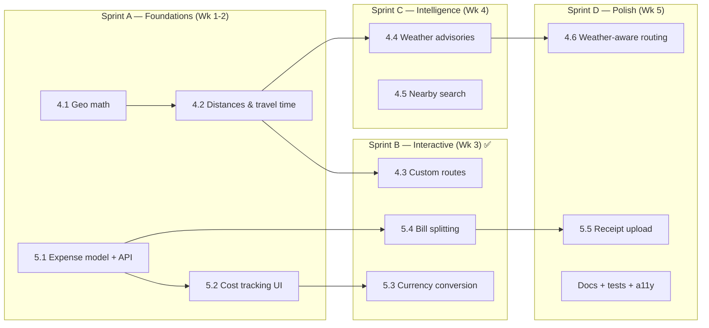

# TravelAI — Roadmap: Map & Geo (Milestone 4) + Budget & Financial (Milestone 5)

> Status: **Sprints A & B implemented** — sub-milestones 4.1, 4.2, 4.3, 5.1, 5.2, 5.3 and 5.4 are shipped (see §9 and §10).
> Continues from **Milestone 1 — Trip Management & Editing** and **Milestone 2 — AI Prompt Improvements**.
> This document breaks the two feature groups into independently shippable sub-milestones with backend, frontend, data-model, testing, and acceptance details.

---

## 0. Current State (baseline)

**Map & Geo**
- `frontend/src/components/dashboard/TripMap.tsx` renders Leaflet (`react-leaflet` + `leaflet`) with a hardcoded `DESTINATION_COORDS` dictionary (80+ hubs) and a Nominatim geocoding fallback.
- Activity `coordinates: [lat, lng]` are already part of the itinerary contract (`ActivityItem`).
- Routes are **straight dashed polylines** between activity pins — no real distance, no travel time, no drawing, no weather, no nearby search.

**Budget & Financial**
- `frontend/src/components/dashboard/BudgetVisualizer.tsx` shows a Recharts donut + daily bar from the **AI-estimated** `budget_breakdown`.
- INR-only, planned-only (no actual spend), no participants, no receipts, no currency conversion.

**Reusable foundations already in place**
- Trip documents store arbitrary itinerary JSON (`tripDetails`) and now expose version snapshots + `generationMeta`.
- Backend has a pure-helper + `node:test` testing convention (`backend/src/services/**`), a TTL cache (`backend/src/services/ai/cache.ts`), Zod validation middleware, and `AppError` error handling.

---

## 1. Guiding Architecture Decisions

1. **Proxy all third-party geo/finance APIs through the backend.** Keeps API keys, CORS, rate limits and provider quirks off the client. New `backend/src/services/geo/*` + `backend/src/services/finance/*` layers.
2. **Cache aggressively per provider** (reuse the TTL cache pattern, but with per-provider TTLs). Weather/currency are time-sensitive; OSM POIs and geocoding are effectively static.
3. **Pure, testable math** for distances, travel time, weather risk, currency conversion and bill settlement — mirror of the Milestone 1/2 approach (`*.ts` + `*.test.ts`).
4. **Keep AI itinerary content and user/trip metadata separate.** Expenses, participants, custom routes, weather cache and currency snapshot live at the **Trip root**, *not* inside `tripDetails` — so they never pollute the AI JSON schema or create noisy version snapshots.
5. **Editing stays gated on `onSave`.** Map drawing and expense editing only render when the trip is persisted/editable (the public shared view stays read-only).
6. **Graceful degradation.** Every external provider has a fallback (haversine when routing is down, stored rate snapshot when FX is down, cached/empty state when weather is unavailable).

---

## 2. Milestone 4 — Map & Geo Features

### 4.1 Geo Math Foundation — `P0`
**Goal:** One shared, dependency-free source of truth for geo math.

- **Backend:** `backend/src/services/geo/distance.ts` — `haversineKm(a, b)`, `pathLengthKm(points)`, `bearing`, `centroid`, `boundingBox`, `formatDistance`, `estimateTravelMinutes(km, mode)`.
- **Frontend:** `frontend/src/lib/geo.ts` — identical pure functions (small, duplicated intentionally to avoid a shared package for now; can be lifted into a `packages/shared` later).
- **Tests:** `distance.test.ts` (known city pairs, zero-distance, antimeridian edge, mode speeds).
- **Acceptance:** distances match reference values within ~0.5%; pure functions have unit tests.
- **Effort:** 0.5–1 dev-day.

### 4.2 Distance & Travel-Time Between Activities — `P0`
**Goal:** Show real distances/times between consecutive activities per day and per day total.

- **Backend:** `POST /api/geo/route` — body `{ points: [[lat,lng],...], mode }` → `{ legs: [{ fromIndex, toIndex, km, minutes }], totalKm, totalMinutes, provider }`. Uses haversine by default; optional OSRM when `GEO_ROUTING_PROVIDER=osrm` (walking/driving profiles), with haversine fallback on failure. Cached by rounded coordinates + mode.
- **Frontend (`TripMap.tsx`, `DayTimeline.tsx`):** per-leg chips between activity cards (`→ 4.2 km · ~12 min drive`), day total in the map filter bar, summed trip distance in `TripHeader` quick stats.
- **Tests:** route-leg assembly, provider fallback, empty/single-point input.
- **Acceptance:** distances render on timeline + map; totals are correct; works offline (haversine).
- **Effort:** 1.5–2 dev-days.

### 4.3 User-Drawn Custom Routes — `P1`
**Goal:** Draw, edit, name and persist custom paths (detours, treks, alternative drives) on the map.

- **New dep:** `@geoman-io/leaflet-geoman-free` (MIT, maintained) *or* `leaflet-draw`. Geoman preferred (better UX, actively maintained).
- **Data model (Trip root):**
  ```ts
  customRoutes: [{
    id: string;
    name: string;
    day?: number;          // optional day association
    color: string;
    mode: 'walk' | 'drive' | 'bike';
    points: [number, number][];
    distanceKm: number;    // computed server-side on save
    createdAt: Date;
  }]
  ```
- **Backend:** `PUT /api/itinerary/:id/routes` (replace list, size-capped e.g. max 20 routes / 500 points each), `DELETE /api/itinerary/:id/routes/:routeId`. Validates coords, recomputes `distanceKm`. Ownership enforced. No version snapshot (metadata, not itinerary content).
- **Frontend:** draw/edit/drag/delete toolbar (only when `onSave` present), rename + colour + mode controls, rendered as solid `Polyline`s with a sidebar list; autosave with debounce.
- **Tests:** route validation (bounds, point caps), distance recompute.
- **Acceptance:** draw → save → reload persists; distances auto-calculated; read-only view cannot draw.
- **Effort:** 2–3 dev-days.

### 4.4 Weather-Integrated Routing & Advisories — `P1`
**Goal:** Warn about rain/flood/heat per day and steer suggestions indoors; optionally route around high-risk areas.

- **Provider:** [Open-Meteo](https://open-meteo.com) (free, no key). Forecast for near dates; climate/seasonal normals fallback for far-future dates.
- **Backend:** `backend/src/services/geo/weather.ts` + `GET /api/geo/weather?lat&lng&start&end` → per-day `{ date, tempMin, tempMax, precipitationMm, precipitationProbability, windKph, riskLevel: none|low|moderate|high, advisories: string[] }`. Risk thresholds tuned for Indian travel (monsoon/landslide warnings). Cache 30–60 min.
- **Frontend:** risk badges + advisory tooltips in `DayTimeline`; map overlay/markers tinted by risk; a **"Suggest indoor alternative"** action that reuses the Milestone 2 prompt with a weather constraint and offers a replacement day.
- **Integration with 4.2 (weather-aware routing, `P2`):** flag legs that cross high-risk days and propose reordering or indoor swaps.
- **Tests:** risk mapping thresholds, advisory text, provider failure → graceful empty state.
- **Acceptance:** per-day weather shown; high-rain days flagged; caching verified.
- **Effort:** 2–3 dev-days.

### 4.5 Nearby Search — `P1`
**Goal:** Find restaurants, cafés, ATMs, pharmacies, fuel and attractions near a planned activity and optionally add them to the itinerary.

- **Provider:** [Overpass API](https://overpass-api.de) (OSM, free). Server-side proxy avoids CORS + applies rate limiting/caching.
- **Backend:** `GET /api/geo/nearby?lat&lng&category=restaurant|cafe|atm|pharmacy|attraction|fuel&radius=2000` → normalized `[{ name, category, coords, distanceKm, tags: { cuisine?, opening_hours? } }]`, sorted by distance, capped (e.g. 20). Cache 24h.
- **Frontend:** "Nearby" panel per day/activity; results as map markers; **"Add as activity"** inserts into that day (reuses existing activity persistence from Milestone 1).
- **Tests:** Overpass response normalization, category mapping, radius guard rails.
- **Acceptance:** search returns results; adding a POI updates+persists the itinerary.
- **Effort:** 2 dev-days.

---

## 3. Milestone 5 — Budget & Financial Features

### 5.1 Expense Ledger Data Model + API — `P0`
**Goal:** Record real spend against the planned budget.

- **Data model (Trip root):**
  ```ts
  participants: [{ id: string; name: string; isMe?: boolean }]
  finance: { baseCurrency: string; exchangeRates?: Record<string, number>; ratesUpdatedAt?: Date }
  expenses: [{
    id: string;
    label: string;
    category: 'accommodation' | 'food_and_drinks' | 'activities_and_entry' | 'local_transport' | 'miscellaneous_buffer' | 'other';
    amount: number;
    currency: string;
    amountInBase: number;
    exchangeRate: number;
    date: Date;
    day?: number;
    paidBy?: string;            // participant id
    split: { mode: 'none' | 'equal' | 'custom'; shares?: { participantId: string; amount: number }[] };
    notes?: string;
    receiptUrl?: string;
    createdAt: Date;
  }]
  ```
  > Embedded subdocuments keep trips atomic and simple. If expense volume becomes large, extract to a dedicated `Expense` collection keyed by `tripId` (documented migration path).
- **Backend:** Zod schemas + `GET/POST /api/itinerary/:id/expenses`, `PUT/DELETE /api/itinerary/:id/expenses/:expenseId`, `PUT /api/itinerary/:id/participants`. Server computes `amountInBase`. Ownership enforced. Expenses are metadata → **no itinerary version snapshots**.
- **Frontend types + `api.ts` methods.**
- **Tests:** schema validation, `amountInBase` computation, auth scoping.
- **Acceptance:** full CRUD over expenses + participants.
- **Effort:** 2 dev-days.

### 5.2 Real-Time Cost Tracking UI — `P0`
**Goal:** Live planned-vs-actual analytics during the trip.

- **Frontend:** new **"Expenses"** tab in `ItineraryDisplay` (7th tab) with an add/edit expense modal, list grouped by day/category, running totals.
- **Analytics (`BudgetVisualizer` extension or new `ExpenseTracker.tsx`):** grouped Recharts bar (planned vs actual per category), variance %, remaining budget, projected overspend, daily burn-down.
- **Acceptance:** adding an expense updates all totals/charts instantly; variance math is correct.
- **Effort:** 2–3 dev-days.

### 5.3 Currency Conversion — `P1`
**Goal:** Support international travellers entering/reading amounts in multiple currencies.

- **Provider:** [Frankfurter](https://frankfurter.app) (ECB, no key) primary; `exchangerate.host` optional; manual override supported.
- **Backend:** `backend/src/services/finance/currency.ts` + `GET /api/geo/currency/rates?base=INR&symbols=USD,EUR,AED,...`. Cache 12h. On trip creation/expense entry, snapshot used rates into `trip.budget.exchangeRates` so totals stay stable offline.
- **Frontend:** base-currency selector; per-expense currency input; totals converted; display currency symbol formatting (reuse/introduce a small `formatMoney(amount, currency)`).
- **Tests:** conversion math, missing-rate fallback to snapshot, symbol formatting.
- **Acceptance:** totals correct across currencies; offline uses snapshot.
- **Effort:** 1.5–2 dev-days.

### 5.4 Bill Splitting Calculator — `P1`
**Goal:** Track who paid and settle group expenses with minimal transfers.

- **Pure logic:** `backend/src/services/finance/settlement.ts` (mirrored in frontend `lib/settlement.ts`) — net balances per participant, then greedy **minimise-transactions** settlement. Also per-person and per-category summaries.
- **UI:** participants manager; per-expense payer + split mode (equal / custom / excluded); "Settle Up" panel showing who owes whom.
- **Tests:** balances sum to zero; unequal/custom shares; multi-payer scenarios; minimal-transfer correctness.
- **Acceptance:** settlement is correct and balanced for all split modes.
- **Effort:** 1.5–2 dev-days.

### 5.5 Receipt Upload — `P2`
**Goal:** Attach receipt images/PDFs to expenses.

- **Backend:** `POST /api/itinerary/:id/expenses/:expenseId/receipt` (multipart via `multer`). Validate MIME (`jpeg/png/webp/pdf`) + size (≤ `MAX_UPLOAD_MB`, default 5). Storage: local `UPLOAD_DIR` (dev) with static serving; **Cloudinary/S3 recommended for serverless prod** (ephemeral disks). Returns `receiptUrl`; delete removes the file.
- **Frontend:** file input + thumbnail preview + remove in the expense modal/row.
- **Security:** sanitize filenames, never trust client MIME alone, auth + ownership on every upload.
- **Acceptance:** upload → preview → delete works; bad types/sizes rejected.
- **Effort:** 1.5–2 dev-days.

---

## 4. Cross-Cutting Work (both milestones)

| Area | Work |
|---|---|
| **Validation** | Zod schemas for every new endpoint (`geo`, `expenses`, `participants`, `routes`, `receipt`). |
| **Caching** | Extend the TTL cache with per-provider TTLs (weather 45 min, FX 12 h, POI/geocode 24 h, routes 24 h). |
| **Rate limiting** | Dedicated limiter for `/api/geo/*` (external providers). |
| **Error handling** | `AppError` for all failures; provider outages degrade gracefully (never 500 the trip view). |
| **Tests** | `node:test` for all pure logic (geo, weather risk, FX, settlement, variance). |
| **Docs** | README: features, endpoint table, directory tree, env vars, architecture diagram. |
| **Types** | `frontend/src/types/trip.ts`: `TripExpense`, `TripParticipant`, `CustomRoute`, `WeatherDay`, `NearbyPlace`, `TripCurrency`. |
| **Responsive/a11y** | Drawing + expense modals mobile-friendly; keyboard-accessible controls; `prefers-reduced-motion` for map fly-to. |

---

## 5. Delivery Sequence



**Sequencing rationale:** geo math + distances and expense ledger + tracking deliver the highest user value first and unblock everything else. Weather and nearby search are additive and independent once distances exist. Receipts and weather-aware routing are the lowest-priority polish items.

**Dependency notes**
- 4.2 depends on 4.1 · 4.3 depends on 4.1/4.2 · 4.6 depends on 4.2 + 4.4.
- 5.2/5.3/5.4/5.5 all depend on 5.1.

---

## 6. New Dependencies

| Package | Purpose | Where | Notes |
|---|---|---|---|
| ~~`@geoman-io/leaflet-geoman-free`~~ | Draw/edit routes on the map | frontend | **Not needed** — 4.3 shipped as a dependency-free click-to-draw mode built on `react-leaflet`'s `useMapEvents` |
| `multer` (+ `@types/multer`) | Receipt multipart upload | backend | Only for 5.5 |
| *(none)* | Distances, weather, FX, settlement | — | Implemented as pure code + `fetch` against free APIs |

New env vars (documented in `backend/.env.example`):

| Variable | Default | Purpose | Shipped |
|---|---|---|---|
| `GEO_ROUTING_PROVIDER` | `haversine` | `haversine` \| `osrm` | ✅ Sprint A |
| `OSRM_BASE_URL` | public demo | Routing provider endpoint | ✅ Sprint A |
| `OVERPASS_ENDPOINT` | public | POI/nearby search | 4.5 |
| `OPEN_METEO_BASE` | public | Weather | 4.4 |
| `CURRENCY_RATES_PROVIDER` | `frankfurter` | FX provider | ✅ Sprint B |
| `CURRENCY_CACHE_TTL_MS` | `43200000` (12h) | FX cache TTL | ✅ Sprint B |
| `UPLOAD_DIR` | `backend/uploads` | Receipt storage (dev) | 5.5 |
| `MAX_UPLOAD_MB` | `5` | Upload size cap | 5.5 |
| `CLOUDINARY_URL` | — | Optional prod receipt storage | 5.5 |

---

## 7. Risks & Mitigations

| Risk | Mitigation |
|---|---|
| Public Overpass/OSRM/Nominatim usage policies or rate limits | Server-side proxy + aggressive caching + configurable endpoints + fallback logic |
| Weather provider outage / far-future dates | Climate/seasonal fallback; degrade to "no advisory" instead of erroring |
| FX provider downtime or stale rates | Snapshot rates onto the trip; manual override |
| Ephemeral disk on Render/Vercel breaks uploads | Recommend Cloudinary/S3 for prod; document local-dev-only path |
| Map-draw saves spamming the API | Debounced autosave + size caps on routes/points |
| Expense array growth hurting trip payloads | Caps + documented migration to a dedicated `Expense` collection |
| Bundle size from Geoman | Lazy-load the map tab / dynamic import of draw plugin |

---

## 8. Definition of Done (per sub-milestone)

- [ ] Backend endpoint(s) implemented with Zod validation + ownership checks.
- [ ] Pure logic extracted and unit-tested with the Node test runner (`npm test`).
- [ ] Frontend UI wired, type-safe (`tsc --noEmit`) and lint-clean for changed files.
- [ ] Changes to itinerary content are persisted; unrelated metadata does **not** create version snapshots.
- [ ] Read-only/shared view stays unaffected.
- [ ] Graceful degradation verified for provider failure/offline.
- [ ] README (features, endpoints, env, structure) updated.
- [ ] `npm run build` (backend + frontend) and `npm test` pass.

---

## 9. Sprint A — Implementation Notes (shipped)

Sprint A delivered the four foundational sub-milestones. Notes and deviations from the plan above:

**Backend**
- `services/geo/distance.ts` — pure haversine/travel-time helpers (kept dependency-free; mirrored on the client rather than shared).
- `services/geo/route.ts` — `computeRoute()` uses haversine by default and OSRM when `GEO_ROUTING_PROVIDER=osrm`, with automatic fallback on any provider error.
- `services/finance/expenses.ts` — `computeAmountInBase`, `computeEqualShares` (rounding-safe), `summarizeExpenses`.
- `POST /api/geo/route` mounted at `/api/geo` (auth required, Zod-validated 2–50 points).
- Expense CRUD + participants endpoints added to `/api/itinerary`; `sanitizeTrip` extracted to `utils/sanitizeTrip.ts` and shared.
- Trip model gained `participants[]`, `expenses[]` and a `finance` root subdocument (**named `finance`, not `budget`, to avoid confusion with the AI `budget_breakdown`**). Equal splits are derived server-side; expenses never create itinerary version snapshots.
- New unit tests: `geo/distance.test.ts`, `geo/route.test.ts`, `finance/expenses.test.ts` (backend suite now **42 tests**).

**Frontend**
- `lib/geo.ts` mirrors the backend math so distances render instantly and offline; `lib/budget.ts` holds category metadata + planned-vs-actual helpers.
- `DayTimeline` shows a distance/time chip between located activities plus a per-day total; `TripMap` shows the selected day's route total, refined by the backend endpoint with a local fallback.
- New `ExpenseTracker` + `ExpenseEditor`, wired as a 7th **Expenses** tab in `ItineraryDisplay`; `Dashboard` passes `expenses`, `participants` and `finance`.
- Travellers can be added/removed; expenses support description, amount, category, date, day, payer and none/equal splitting.

**Deliberately deferred to later sprints** (unchanged from above): custom route drawing (4.3), weather (4.4), nearby search (4.5), currency conversion (5.3), custom/unequal splits + settlement (5.4), receipt upload (5.5).

**Known follow-ups**
- The trips list endpoint returns expenses inline (the dashboard uses it as the detail payload); extract to a dedicated `Expense` collection if ledgers grow large.
- Server-side caching of OSRM responses is not yet implemented (haversine is instant; OSRM is only called on demand for the selected day).

---

## 10. Sprint B — Implementation Notes (shipped)

Sprint B delivered the three interactive sub-milestones. Notes and deviations from the plan above:

**4.3 User-Drawn Custom Routes**
- **Dependency-free drawing**: instead of `@geoman-io/leaflet-geoman-free`, the map has a *Draw Route* mode built on `react-leaflet`'s `useMapEvents`. Clicking the map appends vertices (with undo), the draft renders as a dashed polyline with vertex markers, and *Finish* opens `RouteEditor` (name, travel mode, trip day, colour). This keeps the client bundle lean and matches the earlier decision to prefer native browser primitives over new packages.
- Data model: `customRoutes: [{ name, day?, color, mode, points: [lat,lng][], distanceKm, createdAt }]` hangs off the trip root, so — like expenses — it never creates an itinerary version snapshot.
- Endpoints are **granular** (`POST` / `PUT /:routeId` / `DELETE /:routeId`) rather than the single `PUT /:id/routes` replace-list in the original plan; this is consistent with the rest of the app's editing API.
- Caps enforced server-side: 20 routes per trip, 500 points per route. `services/geo/customRoute.ts` normalizes points (drops out-of-range/malformed coordinates) and always **recomputes `distanceKm`** so clients cannot inject bogus lengths.
- Route list renders below the map with edit/delete; drawn routes also appear in the read-only shared view. Duplicating a trip carries the drawn routes over.
- Tests: `services/geo/customRoute.test.ts` (coordinate filtering, point caps, distance recompute, drawable-route check).

**5.3 Currency Conversion**
- Provider: [Frankfurter](https://frankfurter.app) (ECB reference rates, no API key) for 30 supported currencies, cached in-memory for `CURRENCY_CACHE_TTL_MS` (default 12 h).
- **Rate semantics are explicit and uniform**: `rates[X]` is the value of **one unit of X in the trip's base currency** (base INR → `rates.USD ≈ 85.5`). That is exactly `ITripExpense.exchangeRate`, so `amountInBase = amount * rate` holds for the API, the DB and both mirrors. Frankfurter's inverted `1 base = X` response is flipped once via `invertRates()`.
- `GET /api/geo/currency/rates?base=INR&symbols=…` exposes the snapshot. `PUT /api/itinerary/:id/finance` changes the base currency and/or refreshes rates: it fetches every supported currency in one call, re-converts **all** existing expenses, scales custom shares proportionally (so they still sum to the total), recomputes equal splits and writes `finance.exchangeRates` + `ratesUpdatedAt`.
- Adding an expense in a foreign currency resolves its rate in priority order: explicit `exchangeRate` → trip snapshot → live single-currency lookup → friendly `502` (manual rate always accepted).
- UI: a *Currency & Rates* card in the Expense tab (base-currency selector + refresh), and the expense modal gained a currency selector plus an editable rate with a live "≈ ₹X recorded" preview. Foreign-currency rows show the original amount alongside the converted total.
- Tests: `services/finance/currency.test.ts` (inversion, rounding, missing/invalid rates, lookup bounds, cache).

**5.4 Bill Splitting Calculator**
- Pure logic in `services/finance/settlement.ts` (mirrored frontend-side as `lib/settlement.ts`): `computeBalances()` gives each traveller `paid` / `share` / `net`, and `minimizeTransfers()` runs a greedy largest-debtor-vs-largest-creditor pass producing **at most `n-1` transfers**. All maths runs in integer cents to avoid float drift.
- `splitMode` is `none` (borne entirely by the payer, keeps solo ledgers zero-sum) / `equal` (server-derived, rounding-safe) / `custom` (explicit per-person shares, validated to sum to the expense total within half a cent).
- Removing or adding travellers re-derives equal splits; changing the base currency rescales custom shares by the amount ratio.
- UI: the expense modal offers *Not split / Split equally / Custom amounts* (leave someone at 0 to exclude them, with a live allocated-vs-total indicator), and a *Settle Up* card lists each traveller's balance plus the minimal set of suggested transfers (or "Everyone is settled up").
- Tests: `services/finance/settlement.test.ts` (zero-sum nets, equal/custom/unsplit attribution, multi-payer ledgers, rounding resolution, unknown payers) plus `rescaleShares` / `sharesMatchTotal` cases in `finance/expenses.test.ts`.

**Verification (Sprint B)**: backend `npm run build` ✅ · backend `npm test` **61/61** ✅ (was 42) · frontend `npx tsc --noEmit` ✅ · frontend `npm run build` ✅ · new/changed frontend files ESLint-clean (only the pre-existing `TripMap` `no-empty` and `api.ts` `no-explicit-any` findings remain, untouched).

**Still deferred**: weather advisories (4.4), nearby search (4.5), weather-aware routing (4.6), receipt upload (5.5).
